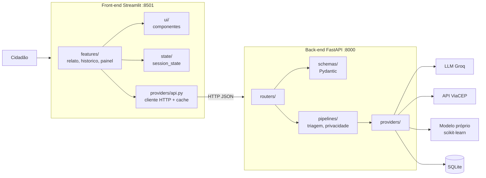

# CitizenTech Triagem: relatos de zeladoria urbana com IA

Global Solution 2026/2, disciplina Front-end em Sistemas de IA.
Aluno: Igor Nakajima, RM 563632 (trabalho individual).

Aplicação web em que o cidadão descreve em linguagem livre um problema na rua (poste apagado, buraco, fio caído,
lixo, árvore, semáforo) e recebe na hora uma orientação clara: assunto, urgência, secretaria responsável, prazo de
referência e o que fazer para se proteger. Antes do envio, o cidadão confere e pode corrigir a classificação feita
pela IA. Depois, avalia se a resposta foi útil.

## 1. Problema e público

**Público:** moradores que precisam avisar a prefeitura sobre problemas de zeladoria urbana, em especial quem tem
pouca familiaridade com sistemas públicos (idosos, pessoas com baixa escolaridade, pessoas com baixa visão).

**Dor concreta:** para abrir um pedido nos canais de atendimento municipais (por exemplo, o SP156 da Prefeitura de
São Paulo, https://sp156.prefeitura.sp.gov.br), o cidadão precisa escolher sozinho, numa lista longa, o "serviço"
certo. Quem escolhe errado tem o pedido encaminhado ao setor errado, devolvido ou atrasado. Quem relata uma situação
de risco (fio caído, semáforo apagado) não recebe, no momento do relato, nenhuma orientação de segurança.

**Base legal:** a Lei 13.460/2017 (Código de Defesa do Usuário do Serviço Público) garante ao cidadão o direito de
apresentar manifestações aos órgãos públicos com linguagem simples e atendimento adequado.

## 2. ODS relacionados

- **ODS 11 (Cidades e comunidades sustentáveis):** encaminhar mais rápido e para o setor certo os problemas de
  iluminação, pavimentação, coleta de lixo e trânsito melhora a segurança e a qualidade de vida no bairro.
- **ODS 16 (Paz, justiça e instituições eficazes):** a meta 16.6 trata de instituições eficazes e transparentes. A
  solução dá protocolo, prazo de referência e um canal em linguagem simples, com revisão humana nos casos duvidosos.

## 3. Fluxo CitizenTech

1. **Entrada:** o cidadão escreve o relato, informa o CEP e, se quiser, o número. O front valida antes do envio
   (texto de 15 a 1000 caracteres, CEP com 8 números) e o back valida de novo com Pydantic.
2. **Processamento inteligente (back-end):** dados pessoais do texto (CPF, e-mail, telefone) são mascarados; o LLM
   (Groq, modelo `openai/gpt-oss-120b`) devolve um JSON validado pelo schema `AnaliseIA`; o CEP é conferido na
   API pública ViaCEP; um modelo próprio (TF-IDF + regressão logística, scikit-learn) dá uma segunda opinião.
3. **Resposta ou ação:** a tela mostra assunto, selo de urgência (cor + texto + ícone), orientação, secretaria,
   prazo e endereço. O cidadão confirma ou corrige o assunto e então o pedido é registrado com protocolo.
4. **Acompanhamento:** aba "Minhas solicitações" com o histórico da sessão e avaliação útil/incorreta; aba
   "Painel da cidade" com gráficos Plotly e filtros.

## 4. Arquitetura



```
backend/
  app/
    main.py            cria a API, CORS restrito
    config.py          lê variáveis de ambiente (.env)
    catalogo.py        assunto -> secretaria e prazo de referência
    routers/           triagem.py (/api/triagem/analisar, /api/categorias, /api/saude), solicitacoes.py
    schemas/           RelatoEntrada, AnaliseIA, AnaliseResultado, Solicitacao, Avaliacao
    pipelines/         triagem.py (prompt, validação, plano B), privacidade.py (mascara dados), solicitacoes.py
    providers/         llm_groq.py, viacep.py, modelo_local.py, repositorio.py (SQLite)
  tests/               testes pytest da API e dos pipelines, sem subir a interface
frontend/
  app.py               layout: sidebar + 3 abas
  features/            relato.py, historico.py, painel.py
  ui/componentes.py    selo_urgencia, cartao_solicitacao, estado_vazio, mensagem_erro, aplicar_tema
  state/sessao.py      todo o st.session_state centralizado
  providers/api.py     cliente HTTP da API, com tratamento de falhas e cache
```

**Onde fica cada coisa pedida no enunciado**

| Requisito | Onde |
|---|---|
| Chamada ao LLM (só no back) | `backend/app/providers/llm_groq.py`, chamado por `pipelines/triagem.py` |
| Saída estruturada Pydantic | `backend/app/schemas/triagem.py` (`AnaliseIA`, `AnaliseResultado`) |
| Estado centralizado | `frontend/state/sessao.py` (análise atual, histórico, protocolo, preferências) |
| Cache | `frontend/providers/api.py`: `@st.cache_resource` (sessão HTTP), `@st.cache_data` (saúde, categorias, solicitações) |
| Falhas tratadas | `frontend/providers/api.py` (API fora do ar, timeout, erro 4xx/5xx, JSON inválido) e plano B no back |
| Segredos | `backend/.env` (fora do git), `backend/.env.example` e `frontend/.env.example` no repositório |
| CORS restritivo | `backend/app/main.py`, origens lidas de `ALLOWED_ORIGINS` (sem `*`) |
| Componente reutilizável | `ui/componentes.py`: `selo_urgencia` (tamanho normal no resultado, compacto dentro de `cartao_solicitacao` no histórico) e `estado_vazio` (histórico e painel, com textos diferentes) |

## 5. Decisões técnicas

- **Streamlit:** o enunciado aceita Streamlit ou Gradio. Streamlit tem abas, colunas, sidebar, `session_state` e
  integração direta com Plotly, que cobrem a jornada em poucas telas com código Python simples.
- **Formato de saída:** JSON com `categoria` e `urgencia` em listas fechadas (`Literal`), `resumo` e `orientacao`
  com tamanho máximo, `sinais_de_risco` e `confianca`. Listas fechadas impedem a IA de inventar categorias, e o
  limite de tamanho impede o "dump de texto". Se a resposta não passa no schema, o back tenta mais uma vez e, se
  falhar de novo, usa o modelo próprio.
- **Prompt:** define a regra de urgência com exemplos concretos de risco, pede orientação em até 3 frases sem
  jargão, com a proteção do cidadão em primeiro lugar, e proíbe inventar dados ou prometer prazos.
- **Plano B com modelo próprio:** se a Groq estiver fora do ar, sem chave ou lenta, o modelo scikit-learn
  classifica o assunto e regras de palavras de risco definem a urgência. O cidadão é avisado e o caso vai para
  revisão humana.
- **Deploy em Docker:** um único `docker compose up` sobe API e front em qualquer máquina com Docker, sem
  depender de conta em plataforma. A URL da API é passada ao front pela variável `API_URL`.

## 6. Ética e limites da IA

**Riscos:** classificar no assunto errado; subestimar a urgência de uma situação de risco; alucinar uma
orientação; viés contra relatos escritos com erros de português ou gírias; uso indevido (trotes, dados pessoais
de terceiros no texto).

**O que a solução NÃO faz:** não substitui o 190, 193 ou 199 em emergência (ela manda ligar); não garante prazo
(o prazo exibido é de referência); não toma decisão final sozinha; não guarda nome, CPF, e-mail ou telefone.

**Mitigações:**
- **Human-in-the-loop:** o cidadão confere o assunto proposto pela IA e pode trocar antes de enviar; depois avalia
  a resposta como útil ou incorreta. Casos com baixa confiança, assunto "outro", CEP não encontrado ou divergência
  entre o LLM e o modelo próprio recebem a marca de revisão sugerida para um atendente.
- **Privacidade (LGPD):** CPF, e-mail e telefone são mascarados antes de o texto sair para o LLM, e só o texto
  mascarado é gravado.
- **Segurança:** regras de palavras de risco no plano B sempre elevam a urgência e mostram os telefones de
  emergência, mesmo sem LLM.

## 7. Acessibilidade aplicada

- Urgência nunca indicada só pela cor: o selo traz cor, ícone e a palavra (Alta, Média, Baixa).
- Cores com contraste adequado sobre fundo claro e escuro.
- Opção "Texto maior" na barra lateral, que aumenta a fonte de toda a interface.
- Rótulos claros em todos os campos, com texto de ajuda e exemplo; nada de jargão técnico (o cidadão nunca vê
  "HTTP 500" ou nomes de campos internos).
- Mensagens de erro dizem o que aconteceu e o que fazer.
- Estados vazios explicados ("Você ainda não enviou nenhum pedido...") em vez de tela em branco.

## 8. Evidências de validação

### 8.1 Casos de teste da IA (execuções reais com a Groq em 19/11/2026)

| # | Entrada | Saída esperada | Saída obtida (1ª versão do prompt) | Ajuste realizado | Saída após o ajuste |
|---|---|---|---|---|---|
| 1 | "Tem um fio de energia caído no chão na frente da escola, as crianças passam por aqui toda hora" | Iluminação pública, urgência alta, orientação de segurança | Assunto **outro**, urgência alta, orientação correta (193/199) | Prompt passou a dizer que postes, lâmpadas e fios da rede elétrica na rua são iluminação pública | Iluminação pública, alta, "Afaste-se do local e mantenha as crianças longe do fio..." |
| 2 | "Gostaria de sugerir que a prefeitura plante mais árvores na praça do bairro" | Árvores e poda, urgência baixa | Assunto **outro**, urgência baixa | Prompt passou a dizer que pedidos de plantio ou remoção de árvores são poda_arvore | Árvores e poda, baixa, Secretaria do Verde e Meio Ambiente |
| 3 | "Tem um buraco enorme no asfalto que já estourou o pneu de dois carros" | Buraco e pavimentação, média, sem mandar o cidadão a outro canal | Assunto e urgência corretos, mas orientação "Registre a ocorrência na prefeitura" | Prompt passou a dizer que o relato já está sendo registrado e não deve mandar o cidadão a outro canal | Assunto correto; a orientação ainda cita "informe à central de atendimento". Ajuste parcial, ponto aberto |
| 4 | "O semáforo do cruzamento está apagado e quase teve acidente agora, meu telefone é 11 98765-4321" | Trânsito e sinalização, alta, telefone mascarado | Trânsito e sinalização, alta, sinais "semáforo apagado" e "quase teve acidente"; telefone enviado ao LLM como [TELEFONE] | Nenhum | Igual |
| 5 | "Quero saber como faço para tirar a segunda via do meu IPTU" | Outro (não é zeladoria), revisão humana | Outro, baixa, revisão sugerida | Nenhum | Igual |
| 6 | Mesmo relato do caso 1 com a Groq indisponível (modelo inexistente, HTTP 404) | Plano B, aviso ao cidadão, urgência alta pela regra de risco | Modelo próprio, urgência alta, sinal "fio elétrico exposto", revisão sugerida, aviso exibido | Nenhum (o assunto do plano B ficou errado, e por isso o caso vai para revisão humana) | Igual |

### 8.2 Teste com pessoas

Roteiro (cerca de 5 minutos por pessoa): 1) abrir o app sem explicação; 2) relatar um problema real da sua rua;
3) conferir e enviar; 4) ver o pedido em "Minhas solicitações" e avaliar; 5) dizer o que estranhou.

| Pessoa (perfil) | O que observou | Ajuste feito |
|---|---|---|
| A PREENCHER | | |
| A PREENCHER | | |
| A PREENCHER | | |

### 8.3 Testes automatizados

```bash
cd backend && pip install -r requirements.txt pytest && python -m pytest -q
```
8 testes da API e dos pipelines, sem subir a interface e sem chamar a Groq de verdade: fluxo completo, LLM fora do
ar, resposta inválida do LLM, fio exposto sem LLM vira urgência alta, validação de entrada, dados pessoais não vão
para o LLM, CEP inexistente pede revisão e CORS restrito.

## 9. Como executar

### Opção recomendada: Docker

```bash
cp backend/.env.example backend/.env      # e coloque sua GROQ_API_KEY (https://console.groq.com/keys)
docker compose up --build
```
- Interface: http://localhost:8501
- API e documentação interativa: http://localhost:8000/docs

Sem chave, a aplicação funciona com o modelo próprio (plano B).

### Sem Docker

```bash
python3 -m venv .venv && source .venv/bin/activate
pip install -r backend/requirements.txt -r frontend/requirements.txt
cp backend/.env.example backend/.env      # coloque sua GROQ_API_KEY
cd backend && uvicorn app.main:app --port 8000      # terminal 1
cd frontend && API_URL=http://localhost:8000 streamlit run app.py   # terminal 2
```

### Variáveis de ambiente

| Variável | Onde | Para quê |
|---|---|---|
| `GROQ_API_KEY` | backend | chave do LLM (nunca versionada) |
| `GROQ_MODEL` | backend | modelo da Groq (padrão `openai/gpt-oss-120b`) |
| `LLM_TIMEOUT_S` | backend | tempo máximo de espera do LLM |
| `ALLOWED_ORIGINS` | backend | origens liberadas no CORS |
| `API_URL` | frontend | endereço da API |
